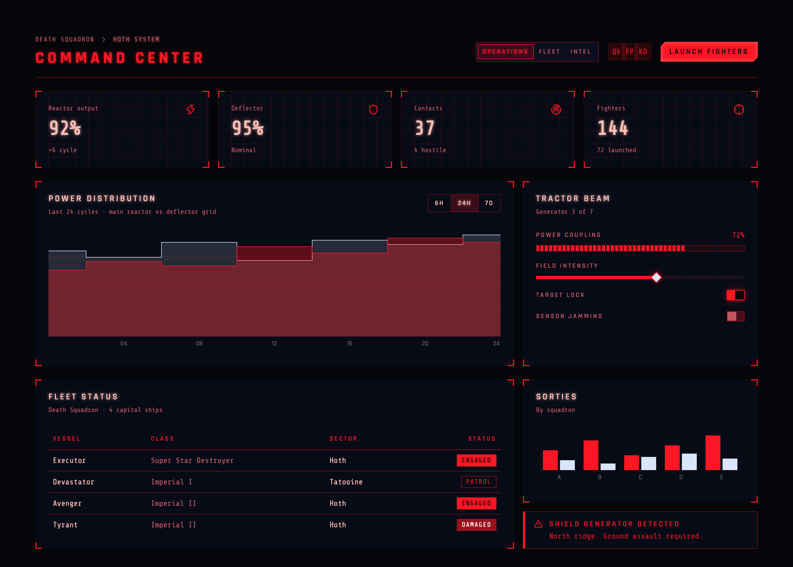
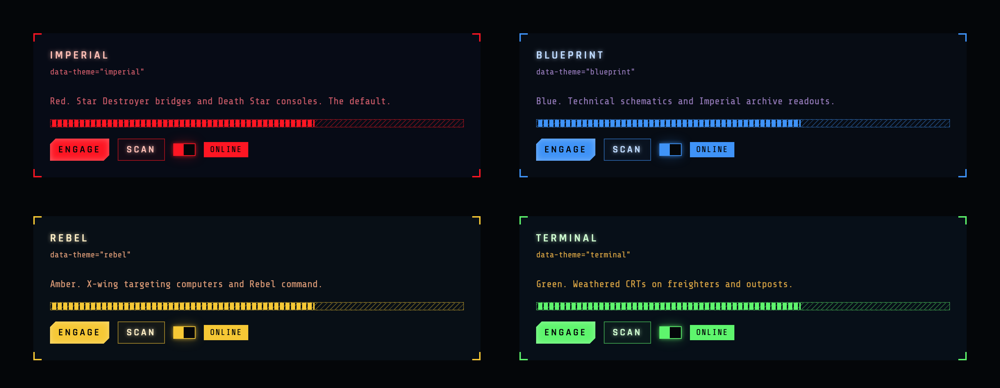
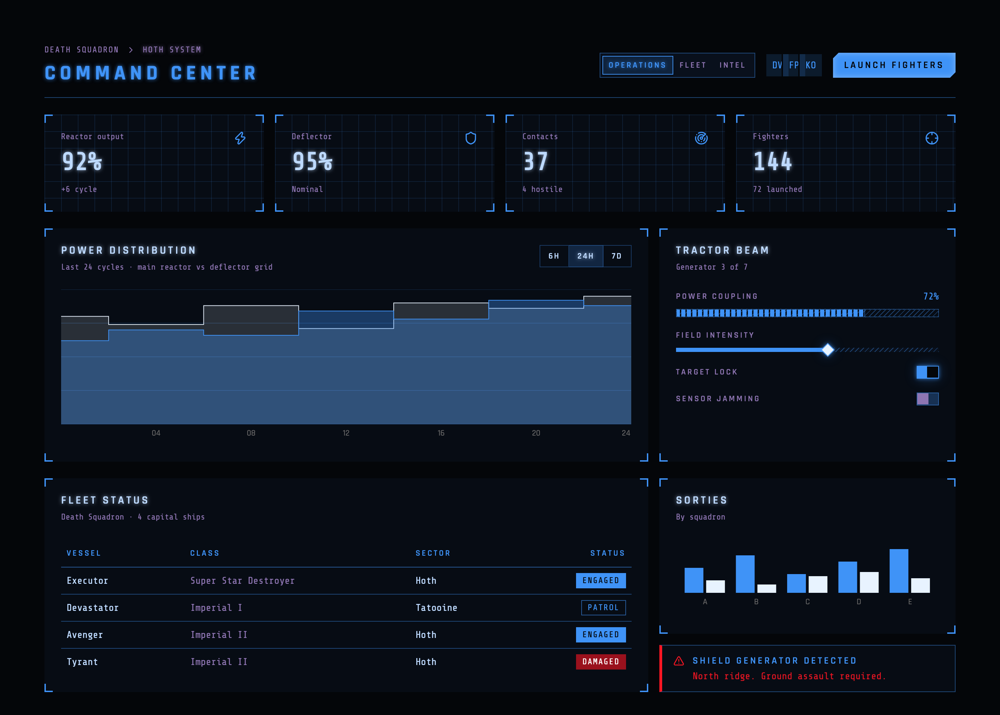
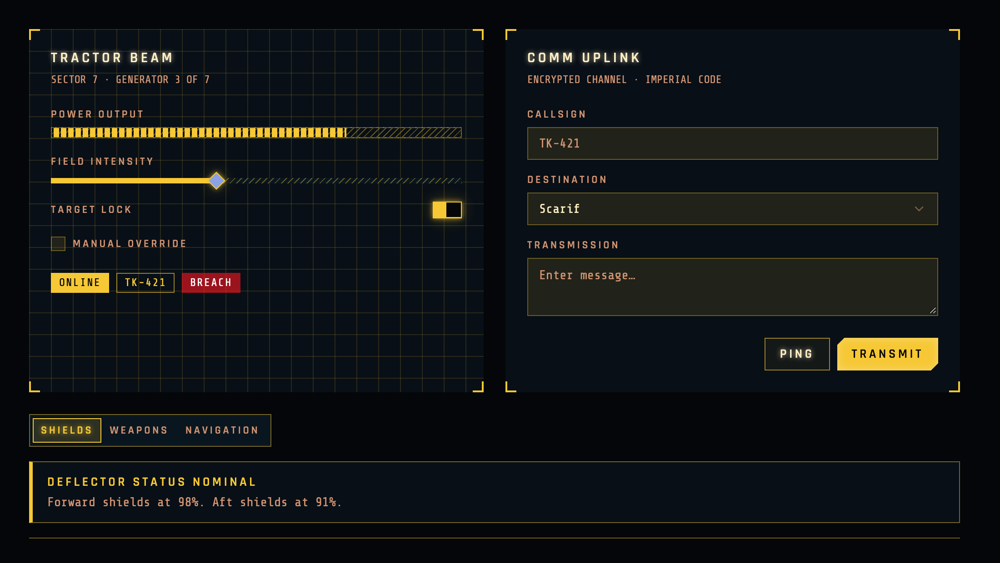

# Grand Moff Tarkit

A React component library built on [shadcn/ui](https://ui.shadcn.com), restyled after the in-universe displays of the
Star Wars films: phosphor line work on black glass, cut corners, HUD brackets, scanlines and targeting grids.

All 58 shadcn components keep their exact shadcn API; only the styling changed. Four console palettes
(`imperial`, `blueprint`, `rebel`, `terminal`) are switched with a `data-theme` attribute.



### Four console palettes

One attribute, every component follows: `<html data-theme="blueprint">`.



<table>
  <tr>
    <td width="50%"></td>
    <td width="50%"></td>
  </tr>
  <tr>
    <td align="center"><code>data-theme="blueprint"</code></td>
    <td align="center"><code>data-theme="rebel"</code></td>
  </tr>
</table>

The screens above are built only from the library's components; see **Examples** in Storybook for their source.

## Usage

```bash
npm install grand-mofftarkit
```

Requires React 19. Works with Vite, Next.js (App Router included; components are marked `"use client"`),
Remix and other React setups. Ships ESM, CommonJS and TypeScript types, and bundlers only include the
components you import.

```tsx
import 'grand-mofftarkit/styles.css' // prebuilt CSS; no Tailwind needed
import { Button } from 'grand-mofftarkit'

<html data-theme="imperial">…<Button>Engage</Button>…</html>
```

Using Tailwind CSS v4? Instead of `styles.css`, replace `@import "tailwindcss";` in your CSS with
`@import "grand-mofftarkit/tailwind.css";` to use the design tokens and utilities in your own code too.

Full documentation, with a live example of every component, lives in Storybook (`pnpm dev`).
Start at **Foundations / Introduction**.

## Development

Install dependencies with `pnpm i` (run `corepack enable` first to enable pnpm).

| Script | What it does |
| --- | --- |
| `pnpm dev` | Storybook with hot reload on http://localhost:6006 |
| `pnpm build` | Static Storybook in `storybook-static/` |
| `pnpm build:lib` | Library bundle and types in `dist/` |
| `pnpm typecheck` | Type-checks the library, stories and Storybook config |
| `pnpm test` | Vitest in watch mode (`pnpm test:cov` for coverage) |
| `pnpm lint` / `pnpm format` | Biome |

### Layout

```
src/lib/components/ui/   shadcn components (restyled)
src/lib/tailwind/theme.css   palettes, tokens and sci-fi utilities
src/lib/index.ts         public exports
src/stories/             Storybook docs, grouped by category
```

### Adding a shadcn component

```bash
pnpm dlx shadcn@latest add <component>
```

If the CLI asks to overwrite an existing file, answer **no**: those files carry the custom styling.
Then restyle the new file to match (see the Introduction page in Storybook), export it from `src/lib/index.ts`,
and add a story under `src/stories/`.

## License

[MIT](LICENSE)
